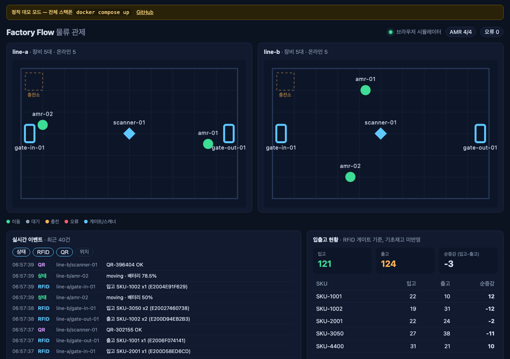
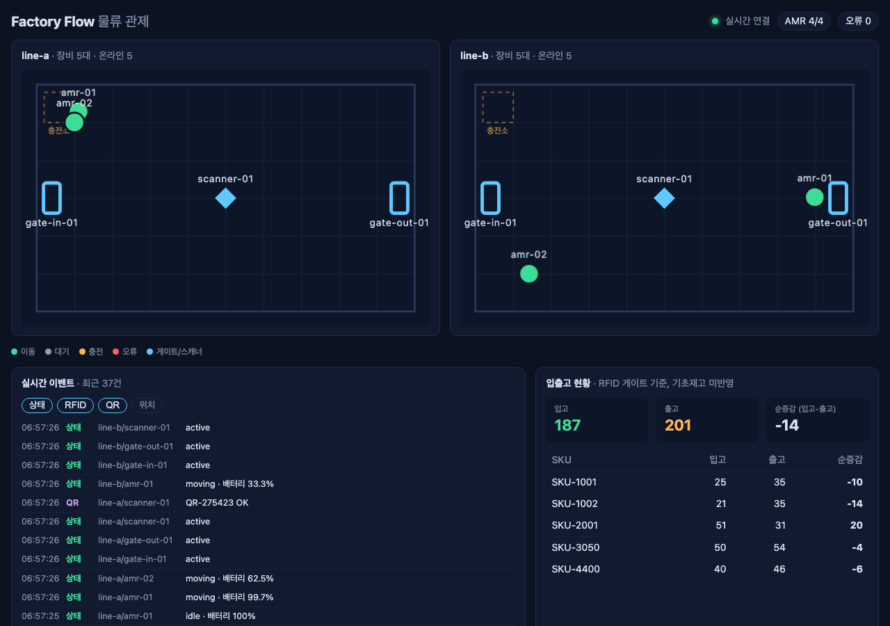
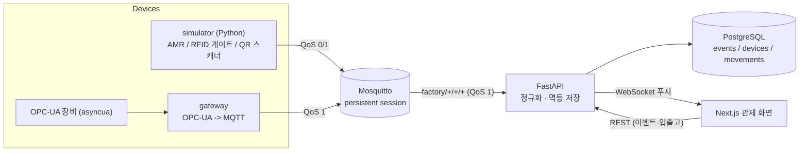

# Factory Flow

**라이브 데모: <https://choibongseok.github.io/factory-flow-demo/>** (정적 데모 모드, 백엔드 없이 브라우저에서 동작)

공장 물류 관제 미니 데모. 가상 AMR·RFID 게이트·QR 스캐너가 MQTT 로 이벤트를 쏘면, API 가 멱등하게 저장하고, 관제 화면이 WebSocket 으로 실시간 표시합니다.



## 실행

```bash
docker compose up        # 처음엔 --build. 이후 http://localhost:3000 (API: http://localhost:8000/docs)
```

선택: OPC-UA 장비 + MQTT 브리지까지 `docker compose --profile opcua up`.

### 정적 데모 모드와 전체 스택

| | 전체 스택 (`docker compose up`) | 정적 데모 (GitHub Pages) |
|---|---|---|
| 이벤트 생산 | Python 시뮬레이터 -> Mosquitto | 브라우저 안의 TS 시뮬레이터 |
| 저장·멱등 | FastAPI + PostgreSQL | 브라우저 메모리 (같은 규칙의 `DemoEngine`) |
| 실시간 | WebSocket | 같은 화면 컴포넌트에 직접 공급 |
| 새로고침 | 데이터 유지 | 90초치 이력을 새로 생성 |
| 용도 | 구조·재접속·멱등성 실증 | 서버 없이 화면 공유 |

정적 데모는 같은 토픽 규약과 페이로드로 이벤트를 만들고, API 와 같은 멱등·최신 상태 우선 규칙을 거칩니다. `NEXT_PUBLIC_DEMO_MODE=static` 일 때만 켜집니다. 화면 상단에 배지가 붙습니다.



## 아키텍처



화면: 라인별 장비 상태 맵(AMR 위치·상태·배터리), 실시간 이벤트 스트림(유형 필터), RFID 기반 입출고 현황(SKU별 입고·출고·순증감).

## 토픽 규약

`factory/{line}/{device}/{event}`

| event | 페이로드 (공통: `event_id`, `ts`) | QoS | 이유 |
|---|---|---|---|
| `position` | `x`, `y`, `heading?` | 0 | 고빈도, 다음 값이 덮어쓰므로 유실 허용 |
| `status` | `state`, `battery?` | 1 | 상태 전이는 놓치면 안 됨 |
| `tag_read` | `tag_id`, `sku`, `direction(in/out)`, `qty`, `rssi?` | 1 | 입출고 집계의 원천 |
| `scan` | `code`, `result(ok/fail)` | 1 | 스캔 이력 |

예: `factory/line-a/gate-in-01/tag_read` -> `{"event_id":"…","ts":"2026-01-01T09:00:00Z","tag_id":"E200…","sku":"SKU-1001","direction":"in","qty":1}`

장비 종류는 장치 이름 접두어(`amr-`, `gate-`, `scanner-`)로 추정합니다.

## REST / WebSocket

| | |
|---|---|
| `GET /api/devices?line=` | 장비 목록과 최신 상태, `online`(마지막 이벤트가 20초 이내) |
| `GET /api/events?line=&device=&type=&limit=&before=` | 이벤트 조회 (최신순, 최대 500) |
| `GET /api/inventory?line=` | RFID 기반 SKU별 입고·출고·순증감 (기초재고 미반영) |
| `GET /api/movements?line=&limit=` | 입출고 내역 |
| `GET /health` | 수신·저장·중복·거부 카운터, MQTT 연결 상태 |
| `WS /ws` | 접속 시 `snapshot`(장비 목록), 이후 `event`(이벤트 + 갱신된 장비 상태) |

## 설계 결정

**QoS.** 위치는 QoS 0, 상태·태그·스캔은 QoS 1 로 보냅니다. 구독은 QoS 1 이지만 브로커는 발행 QoS 와 구독 QoS 중 낮은 쪽으로 전달하므로 위치는 0 으로 남습니다. QoS 1 은 "최소 한 번" 이라서 중복이 생길 수 있고, 이는 아래 멱등성으로 흡수합니다. QoS 2 는 핸드셰이크 비용에 비해 얻는 것이 없어 쓰지 않았습니다.

**멱등성.** 모든 이벤트에는 발행자가 정한 `event_id` 가 있고 `events.event_id` 가 기본키입니다. `INSERT … ON CONFLICT DO NOTHING` 이 0행이면 중복으로 보고 장비 상태 갱신·입출고 집계·WebSocket 푸시를 모두 건너뜁니다. 같은 입고 태그가 두 번 와도 재고는 한 번만 오릅니다. 시뮬레이터는 `DUP_RATE`(기본 3%) 로 일부러 같은 메시지를 두 번 보내 이 경로를 계속 태웁니다(`/health` 의 `duplicates`). `event_id` 가 없는 장비를 위해 토픽+본문 해시로 ID 를 만들어 재전송도 같은 ID 가 되게 했고, OPC-UA 게이트웨이는 기계의 시퀀스 번호로 ID 를 만들어 재시작 후 재읽기도 걸러집니다.

**순서 역전.** 장비 최신 상태는 `ts` 가 더 새로울 때만 덮어씁니다. 늦게 도착한 오래된 이벤트는 로그에는 남고 현재 위치는 바꾸지 않습니다.

**재접속.** 세 곳 모두 지수 백오프(1초에서 30초)로 다시 붙습니다.
- API 구독자: 고정 client id + `clean_session=False` + QoS 1 구독이라, API 가 내려가 있는 동안 브로커가 메시지를 쌓았다가 재접속 때 전달합니다 (Mosquitto 는 `persistence true`).
- 시뮬레이터: 전송 불가 시 메모리 아웃박스(최대 5000건)에 쌓고, 붙으면 마지막 미전송 메시지부터 다시 보냅니다. 가득 차면 오래된 것부터 버립니다.
- 웹: WebSocket 이 끊기면 백오프 재시도하고, 재접속 시 스냅샷과 이벤트·입출고를 다시 받아옵니다.
- `docker compose restart mosquitto` 로 확인할 수 있습니다. 1~2초 안에 api 와 simulator 가 다시 붙습니다.

**오프라인 판정.** 별도 하트비트 대신 장비의 마지막 이벤트 시각으로 `online` 을 계산합니다(20초 기준). 시뮬레이터가 죽으면 모든 장비가 흐려집니다.

**알려진 한계.** 데모이므로 Mosquitto 는 익명 허용·평문이고, API 는 메시지를 받은 뒤 DB 에 쓰므로 그 사이 API 가 죽으면 그 한 건은 유실될 수 있습니다(수동 ACK 로 바꾸면 해결). 입출고 현황은 기초재고 없이 게이트 통과량의 합입니다.

## OPC-UA (선택)

`gateway/opcua_server.py` 가 컨베이어(스캔 코드, 파셀 수, 가동 여부) 를 노출하는 OPC-UA 서버이고, `gateway/bridge.py` 가 변수를 폴링해 `factory/line-a/scanner-opcua-01/{scan,status}` 로 발행합니다. 프로파일을 켜면 화면 이벤트 스트림에 `scanner-opcua-01` 이 나타납니다.

## 테스트·검증

```bash
make verify    # pytest(api, simulator) + 브라우저 시뮬레이터 테스트 + web 빌드 2종
```

- `api/tests` (pytest): 토픽·페이로드 검증, 중복 무시, 순서 역전, 입출고 집계, REST, WebSocket.
- `simulator/tests` (pytest), `web/src/lib/demoSim.test.ts` (node:test).
- pytest 는 Docker 가 있으면 `python:3.12` 컨테이너에서, 없으면 로컬 `.venv` 에서 돕니다.

## GitHub Pages 배포

로컬에서 빌드해 gh-pages 브랜치로 배포합니다.

```bash
make pages                 # 정적 빌드 -> gh-pages 브랜치에 커밋 (main 은 건드리지 않음)
git push origin gh-pages   # 공개할 때
```

저장소 Settings > Pages 에서 Source 를 "Deploy from a branch", 브랜치를 `gh-pages` / root 로 한 번만 지정합니다. 경로는 `NEXT_PUBLIC_BASE_PATH`(기본 `/factory-flow-demo`) 로 바꿀 수 있습니다.

## 구성

```
simulator/  Python 가상 장비 + 발행기     api/     FastAPI, SQLAlchemy(asyncpg), aiomqtt
web/        Next.js App Router(TS)        gateway/ OPC-UA 서버 + MQTT 브리지 (선택)
mosquitto/  브로커 설정                    docs/    스크린샷
```
