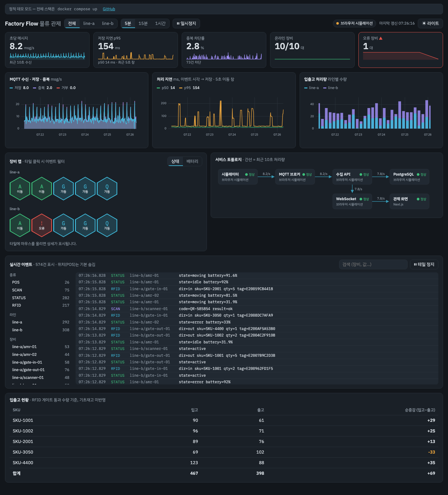
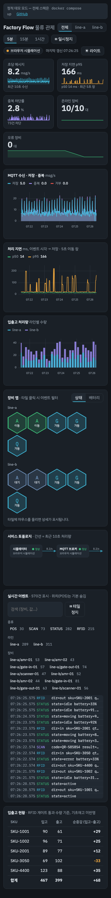
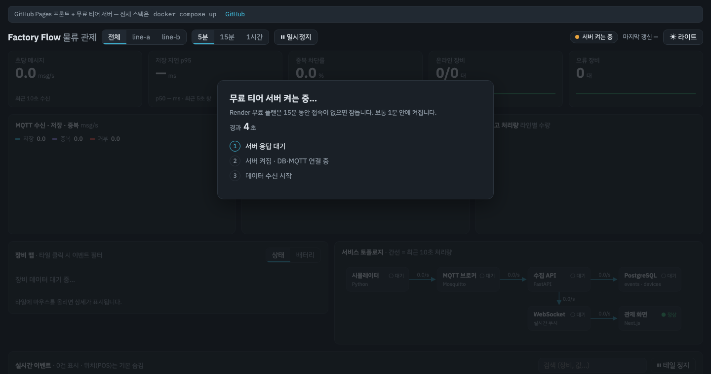
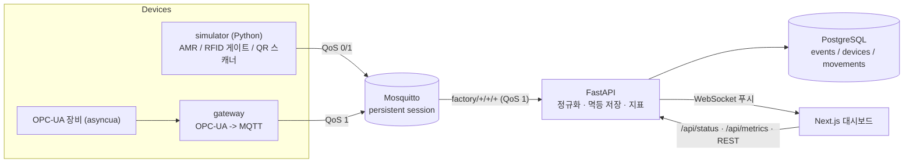

# Factory Flow

**라이브 데모: <https://choibongseok.github.io/factory-flow-demo/>**

공장 물류 실시간 관측 대시보드. 가상 AMR·RFID 게이트·QR 스캐너가 MQTT 로 이벤트를 보내면, API 가 이벤트 ID 기준으로 멱등하게 저장하고, 대시보드가 WebSocket 으로 지표·장비 상태·이벤트 스트림을 실시간으로 보여줍니다.



<p>
  
  
</p>

## 실행

```bash
docker compose up --build    # 대시보드 http://localhost:3000, API 문서 http://localhost:8000/docs
```

선택: OPC-UA 장비 + MQTT 브리지까지 `docker compose --profile opcua up`.

### 세 가지 실행 방식

| | 전체 스택 (`docker compose up`) | GitHub Pages + 실제 서버 | GitHub Pages 만 (브라우저 시뮬레이션) |
|---|---|---|---|
| 이벤트 생산 | Python 시뮬레이터 -> Mosquitto | 같음 (서버 컨테이너 안) | 브라우저 안의 TS 시뮬레이터 |
| 저장·멱등 | FastAPI + PostgreSQL | 같음 (외부 호스팅 Postgres) | 브라우저 메모리 (같은 규칙의 엔진) |
| 지표 | `/api/metrics` | 같음 | 브라우저 엔진이 같은 방식으로 계산 |
| 첫 화면 | 바로 | 무료 서버가 잠들어 있으면 최대 1분 대기 패널 | 바로 |
| 데이터 출처 표시 | 실시간 서버 | 서버 켜는 중 -> 실시간 서버 | 브라우저 시뮬레이션 |

실제 서버에 붙는 빌드는 무료 서버가 잠들어 있을 때 **지연을 숨기지 않습니다.** "무료 티어 서버 켜는 중…" 패널에 경과 초와 단계(서버 응답 대기 -> DB·MQTT 연결 중 -> 데이터 수신 시작)를 보여주고, 90초가 지나도 응답이 없으면 [다시 시도] 와 [브라우저 시뮬레이션으로 보기] 를 고르게 합니다. 시뮬레이션은 사용자가 고를 때만 켜지고, 상단의 출처 표시가 계속 남습니다. 연결 중 끊기면 "서버 연결 끊김, 다시 연결하는 중" 을 띄우고 재시도합니다.

## 대시보드 구성

1. **상단 바**: 라인 필터, 시간 범위(5분/15분/1시간), 일시정지·재개, 마지막 갱신 시각, 데이터 출처, 서버 상태, 다크/라이트
2. **KPI 타일 5개**(스파크라인 포함): 초당 메시지, 저장 지연 p95, 중복 차단률, 온라인 장비, 오류 장비
3. **시계열 차트 3개**: 수신·저장·중복(누적 영역), 처리 지연 p50/p95(5초 이동 창), 라인별 입출고 처리량(막대)
4. **장비 맵**: 장비 하나 = 육각 타일, 라인별 그룹, 색 = 상태 또는 배터리, 타일 클릭 시 이벤트 필터
5. **서비스 토폴로지**: 시뮬레이터 -> MQTT 브로커 -> 수집 API -> PostgreSQL / WebSocket -> 관제 화면, 간선에 초당 처리량, 노드에 상태(정상/대기/이상)
6. **실시간 이벤트 테일**: 종류·라인·장비 패싯, 검색, 줄 단위 스트림, 정지
7. **입출고 현황**: SKU별 입고·출고·순증감 (RFID 게이트 통과 수량 기준, 기초재고 미반영)

색만으로 상태를 구분하지 않고(글자·기호 병기), 키보드 포커스와 `prefers-reduced-motion` 을 따릅니다. 모바일에서는 1열로 접힙니다. 차트는 uPlot(고정 버전), 글꼴은 IBM Plex 를 `next/font` 로 자체 호스팅합니다.

## 아키텍처



호스팅 배포(`deploy/live`)는 Mosquitto(컨테이너 안 localhost 전용)·시뮬레이터·API 를 한 컨테이너에 묶고 DB 만 외부 Postgres 를 씁니다. MQTT 경로(시뮬레이터 -> 브로커 -> API 구독)는 그대로입니다.

## 토픽 규약

`factory/{line}/{device}/{event}`

| event | 페이로드 (공통: `event_id`, `ts`) | QoS | 이유 |
|---|---|---|---|
| `position` | `x`, `y`, `heading?` | 0 | 고빈도, 다음 값이 덮어쓰므로 유실 허용 |
| `status` | `state`, `battery?` | 1 | 상태 전이는 놓치면 안 됨 |
| `tag_read` | `tag_id`, `sku`, `direction(in/out)`, `qty`, `rssi?` | 1 | 입출고 집계의 원천 |
| `scan` | `code`, `result(ok/fail)` | 1 | 스캔 이력 |

예: `factory/line-a/gate-in-01/tag_read` -> `{"event_id":"…","ts":"2026-01-01T09:00:00Z","tag_id":"E200…","sku":"SKU-1001","direction":"in","qty":1}`

장비 종류는 장치 이름 접두어(`amr-`, `gate-`, `scanner-`)로 추정합니다.

## REST / WebSocket

| | |
|---|---|
| `GET /api/status` | 가장 먼저 부르는 가벼운 상태 확인. DB·브로커를 기다리지 않고 즉시 응답합니다. `state`(starting/ready/degraded), `checks`(db, mqtt, simulator, ingest), `uptime_s`, `version` |
| `GET /api/metrics?seconds=&step=&line=` | 초 단위 버킷 시계열(수신·저장·중복·거부, p50/p95, 라인별 입출고)과 구간 요약 |
| `GET /api/devices?line=` | 장비 목록과 최신 상태, `online`(마지막 이벤트가 20초 이내) |
| `GET /api/events?line=&device=&type=&limit=&before=` | 이벤트 조회 (최신순, 최대 500) |
| `GET /api/inventory?line=` | RFID 기반 SKU별 입고·출고·순증감 (기초재고 미반영) |
| `GET /api/movements?line=&limit=` | 입출고 내역 |
| `GET /health` | 호스팅 헬스체크용. 수신·저장·중복·거부 카운터, MQTT 연결 상태 |
| `WS /ws` | 접속 시 `snapshot`(장비 목록), 이후 `event`(이벤트 + 갱신된 장비 상태). 허용된 origin 만 접속 |

`state` 규칙: 세 check(db, mqtt, simulator)가 모두 ok 이고 최근 10초 안에 이벤트가 있으면 `ready`, 하나라도 pending 이면 `starting`, error(또는 이벤트가 끊긴 시뮬레이터)가 있으면 `degraded`.

## 설계 결정

**QoS.** 위치는 QoS 0, 상태·태그·스캔은 QoS 1 로 보냅니다. 구독은 QoS 1 이지만 브로커는 발행 QoS 와 구독 QoS 중 낮은 쪽으로 전달하므로 위치는 0 으로 남습니다. QoS 1 은 "최소 한 번" 이라서 중복이 생길 수 있고, 이는 아래 멱등성으로 흡수합니다. QoS 2 는 핸드셰이크 비용에 비해 얻는 것이 없어 쓰지 않았습니다.

**멱등성.** 모든 이벤트에는 발행자가 정한 `event_id` 가 있고 `events.event_id` 가 기본키입니다. `INSERT … ON CONFLICT DO NOTHING` 이 0행이면 중복으로 보고 장비 상태 갱신·입출고 집계·WebSocket 푸시·저장 지표를 모두 건너뜁니다(중복은 별도 카운터로 셉니다). 시뮬레이터는 `DUP_RATE`(기본 3%) 로 일부러 같은 메시지를 두 번 보내 이 경로를 계속 태웁니다. `event_id` 가 없는 장비를 위해 토픽+본문 해시로 ID 를 만들어 재전송도 같은 ID 가 되게 했고, OPC-UA 게이트웨이는 기계의 시퀀스 번호로 ID 를 만들어 재시작 후 재읽기도 걸러집니다.

**순서 역전.** 장비 최신 상태는 `ts` 가 더 새로울 때만 덮어씁니다. 늦게 도착한 오래된 이벤트는 로그에는 남고 현재 위치는 바꾸지 않습니다.

**재접속.** 모든 연결이 지수 백오프(1~30초)로 다시 붙습니다.
- API 구독자: 고정 client id + `clean_session=False` + QoS 1 구독이라, API 가 내려가 있는 동안 브로커가 메시지를 쌓았다가 재접속 때 전달합니다.
- 시뮬레이터: 전송 불가 시 메모리 아웃박스(최대 5000건)에 쌓고, 붙으면 마지막 미전송 메시지부터 다시 보냅니다. 가득 차면 오래된 것부터 버립니다.
- 웹: WebSocket 이 끊기면 "다시 연결하는 중" 을 표시하고 `/api/status` 로 서버가 돌아올 때까지 확인한 뒤 다시 붙습니다.
- `docker compose restart mosquitto` 로 확인할 수 있습니다. 1~2초 안에 api 와 simulator 가 다시 붙습니다.

**상태 확인을 먼저.** 무료 호스팅은 잠들었다 깨는 데 1분쯤 걸립니다. API 는 스키마 준비와 MQTT 연결을 백그라운드로 돌리고 HTTP 포트를 먼저 엽니다. 그래서 `/api/status` 가 DB·브로커를 기다리지 않고 즉시 `starting` 을 답할 수 있고, 프론트는 이 응답으로 단계를 보여줍니다.

**지표.** 초 단위 버킷을 메모리에 두고(저장하지 않음) 조회할 때 `step` 초로 합칩니다. 백분위는 nearest-rank, 시리즈의 p50/p95 는 5초 이동 창이라 1초짜리 바늘 없이 읽힙니다. 같은 규칙을 API(`api/app/metrics.py`)와 브라우저 엔진(`web/src/lib/metrics.ts`)이 각각 구현하고 같은 시나리오로 시험합니다. 시뮬레이션 모드의 저장 지연은 브로커 구간이 없어 시뮬레이션 값입니다.

**오프라인 판정.** 별도 하트비트 대신 장비의 마지막 이벤트 시각으로 `online` 을 계산합니다(20초 기준).

**알려진 한계.** 데모이므로 Mosquitto 는 익명 허용·평문이고(호스팅 배포에서는 localhost 전용), API 는 메시지를 받은 뒤 DB 에 쓰므로 그 사이 API 가 죽으면 그 한 건은 유실될 수 있습니다(수동 ACK 로 바꾸면 해결). 입출고 현황은 기초재고 없이 게이트 통과량의 합입니다.

## OPC-UA (선택)

`gateway/opcua_server.py` 가 컨베이어(스캔 코드, 파셀 수, 가동 여부)를 노출하는 OPC-UA 서버이고, `gateway/bridge.py` 가 변수를 폴링해 `factory/line-a/scanner-opcua-01/{scan,status}` 로 발행합니다. 변환 로직(`gateway/convert.py`)은 네트워크 없이 시험할 수 있게 분리했습니다.

## 테스트

테스트 케이스 전체 표(시나리오, 입력, 기대 결과, 대응 테스트 함수)는 **[docs/TEST_CASES.md](docs/TEST_CASES.md)** 에 있고, 표의 행 수와 실제 테스트 수가 같은지 `make verify` 가 확인합니다.

| 묶음 | 개수 | 실행 |
|---|---|---|
| API (pytest) | 46 | `make test-api` |
| 시뮬레이터 (pytest) | 4 | `make test-sim` |
| 게이트웨이 (pytest) | 7 | `make test-gateway` |
| 웹 단위 (node:test) | 31 | `make test-web` |
| E2E (Playwright) | 13 | `make test-e2e` |
| 실스택 통합 (Mosquitto + PostgreSQL) | 6 | `make test-integration` |
| **합계** | **107** | |

```bash
make verify              # 위에서 통합을 뺀 101건 + 문서 대조 + web 빌드 2종
make test-integration    # 실제 Mosquitto·PostgreSQL·API 를 띄워 6건 (Docker 필요)
```

- pytest 는 Docker 가 있으면 `python:3.12` 컨테이너에서, 없으면 로컬 `.venv` 에서 돕니다.
- E2E 는 정적 모드를 빌드해 로컬 Chrome 으로 구동합니다(없으면 `PW_CHANNEL= make test-e2e` 로 Playwright Chromium). 서버 연결 흐름(켜는 중 -> 연결, 시간 초과, 끊김 -> 재연결)은 목 서버로 시험합니다.

## 배포 (GitHub Pages + Render + 외부 Postgres)

프론트는 GitHub Pages, 백엔드(브로커+시뮬레이터+API)는 Render 무료 웹 서비스, DB 는 외부 무료 Postgres 입니다. 가입과 값 입력은 직접 해야 하며, 저장소에는 계정·비밀값이 없습니다.

1. **Postgres 준비**: 무료 호스팅 Postgres(예: Neon)에 프로젝트를 만들고 연결 문자열(`postgresql://<user>:<password>@<host>/<db>?sslmode=require`)을 복사합니다.
2. **Render 에서 Blueprint 생성**: New > Blueprint 로 이 저장소를 연결하면 `render.yaml` 을 읽어 서비스 `factory-flow-live` 를 만듭니다. 입력창이 뜨면 `DATABASE_URL` 에 1번의 연결 문자열을 붙여 넣습니다(`sync: false` 라서 저장소에는 값이 없습니다). `CORS_ORIGINS` 는 Pages 주소(`https://choibongseok.github.io`)로 이미 들어 있습니다.
3. **확인**: 배포가 끝나면 `https://<서비스 이름>.onrender.com/api/status` 가 `{"state":"ready", …}` 를 돌려주는지 봅니다.
4. **Pages 재배포**: 아래 명령은 서버 주소를 넣어 정적 빌드를 만들고 `gh-pages` 브랜치에 커밋합니다.
   ```bash
   make pages API_BASE=https://<서비스 이름>.onrender.com
   git push origin gh-pages     # 공개할 때
   ```
   Pages 설정(한 번만): Settings > Pages > Source = "Deploy from a branch", Branch = `gh-pages` / root. 경로는 `NEXT_PUBLIC_BASE_PATH`(기본 `/factory-flow-demo`)로 바꿀 수 있고, `API_BASE` 를 빼면 브라우저 시뮬레이션만 있는 빌드가 됩니다.

주의
- 무료 웹 서비스는 15분 동안 들어오는 요청이 없으면 잠들고, 깨는 데 보통 1분쯤 걸립니다. 그래서 첫 접속은 느리고, 화면이 그 시간을 그대로 보여줍니다. 열린 WebSocket 으로 메시지가 오가는 동안에는 깨어 있습니다.
- 파일시스템이 휘발성이라 컨테이너 안에 저장하는 것이 없고, 이벤트는 외부 Postgres 에만 쌓입니다. `EVENT_RETENTION_HOURS=24` 가 오래된 이벤트를 10분마다 지워 무료 용량(1GB)을 넘지 않게 합니다.
- 호스팅 Postgres 연결 문자열의 `sslmode` 같은 옵션은 API 가 asyncpg 형식으로 바꿔 씁니다. 연결 풀러 주소(`-pooler`)도 처리합니다.

## 구성

```
simulator/  Python 가상 장비 + 발행기      api/      FastAPI, SQLAlchemy(asyncpg), aiomqtt
web/        Next.js App Router(TS)         gateway/  OPC-UA 서버 + MQTT 브리지 (선택)
deploy/live 한 컨테이너 배포 (render.yaml)  integration/ 실스택 통합 테스트
mosquitto/  브로커 설정                     docs/     스크린샷, TEST_CASES.md
```
